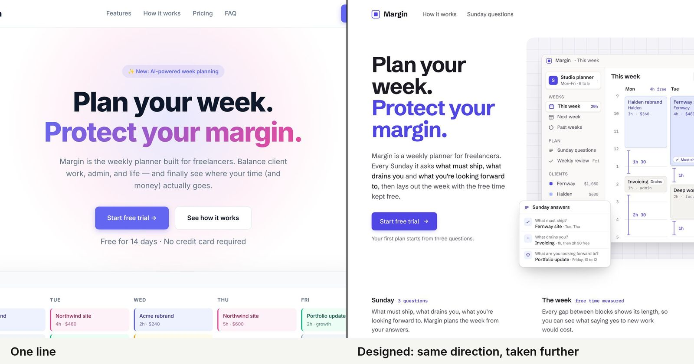

# agentic-design-kit

Eleven first-party skills for AI-assisted interface design, review and refinement. Explore from
real references, build a selected direction, review the rendered result, and create reusable visual
guidelines and design systems.

The kit replaces its earlier external design-skill dependencies with its own workflows. It treats
common AI-design patterns as contextual signals: a gradient, rounded card or illustration can earn
its place. Passing a detector is a quality floor, not proof of good design.

## Background reading

Steven Smith’s field report explains the design approach behind the kit: context, visual
references, exploration, reusable guidelines and review. Some examples use earlier kit versions.

- [English: Designed, not generated](https://stevensmith.dev/writing/designed-not-generated)
- [日本語: 生成ではなく、デザインを。](https://stevensmith.dev/ja/writing/designed-not-generated)

## Choose how to use it

| Package | Use | Installation scope |
|---|---|---|
| `agentic-design-kit-2.0.1-portable.zip` | A connected folder in Cowork or another file-capable agent | No account installation; explicitly direct the agent to START-HERE.md |
| `agentic-design-kit-2.0.1-plugin.zip` | A native Claude plugin | Installed/enabled through Claude; account availability is broader than one folder |
| `agentic-design-kit-2.0.1-code.zip` | Project-local Claude Code skills | Copy the supplied project files into a chosen project after checking conflicts |
| `agentic-design-kit-2.0.1-source.zip` | Contributing, auditing or building the packages | Source, tests and build tools; no prior project outputs |

See [INSTALL.md](INSTALL.md) for the layout and checks for each mode. A folder being readable does
not register native skills. Plugin commands use the namespace `/agentic-design-kit:<skill>`.

## Start with an outcome

After giving the agent access to the kit, ask it to read START-HERE.md and use the kit. Examples:

- “Study these screenshots and propose three directions for this workshop landing page.”
- “Build the selected direction, using our existing brand guidelines and component library.”
- “Review this page for generic design, UI/IA problems and inconsistencies with our system.”
- “Refine the selected page using these findings. Keep the approved direction.”
- “Create visual brand guidelines and a reusable system from this approved direction.”
- “Check whether these screens still apply our guidelines, tokens and components consistently.”

Provide original reference images, real content and assets where possible. The agent should ask
material questions and can make professional design choices when you delegate them. Keep generated
placeholders and sample data distinct from verified product evidence.

## New projects stay separate from the kit

If you open the kit itself and ask for a new page/app, the agent creates a separate sibling
project instead of putting application files in the kit checkout. You can give another destination.
An existing application remains the workspace for additions and reviews.

    python3 scripts/create-project.py --name workshop-site

The helper chooses a free name, refuses an existing explicit destination, and pins the full kit in
`.agentic-design-kit/` with relative AGENTS.md/CLAUDE.md pointers. Later builds, reviews, brand/system
work and refinements use that snapshot; only relevant workflow bodies load. The project remains
portable if moved. It installs nothing globally. You can also reference an external kit from an
existing project instead of copying it. When the host cannot access a separate folder, supply an
accessible project location rather than using the kit as the app's workspace.

## Workflows

| Skill | Responsibility |
|---|---|
| `direction-study` | Reference interpretation, alternatives and narrow proofs; stops for your decision |
| `design-build` | Implement a selected direction, encode its system, render and delegate review |
| `ui-design-principles` | UI craft and accessibility while work is made |
| `design-review` | Independent review lenses and a bounded production repair pass |
| `distinctiveness-review` | Genericness, AI tells, category defaults and sameness |
| `ui-design-review` | UI correctness, static/browser detectors and code scans |
| `design-refine` | Read-only critique or authorized, scoped refinement |
| `ia-review` | Task structure, navigation, grouping, labels and disclosure |
| `ui-design-system` | Visual guidelines; create/extract systems; coherence and drift checks |
| `brand-to-system` | Derive tokens from a compatible structured light-ground brand |
| `starter-directions` | Opt-in starting points when direction is absent or explicitly requested |

A visual study is not a production sign-off. Reviews preserve disagreements and unassessed areas.
Once a direction is selected, future work should use its approved guidelines, DESIGN.md, tokens and
existing components. The kit supports iteration; it cannot guarantee a particular visual result.

## Requirements and evidence

Use an agent with file/code access. Review orchestration needs independent contexts or must report
degraded isolation. Deterministic tools use Bash, Python 3 and Node.js 22 or later; rendered checks
need a compatible Chromium browser. There is no package-manager dependency for the detectors.
Image generation is optional and uses the host's tools and quota.

The baseline was accepted after practical direction-study comparisons. Automated suites cover
routing, locks, fixtures, token relationships and static/browser checks. Model evaluation JSON files
are definitions, not automatically executed benchmarks. The agent-led brand-authoring route has
not yet had a separate creative acceptance benchmark. The deterministic brand deriver remains
limited to its documented light-ground model. See [CHANGELOG.md](CHANGELOG.md).

## Licence and contribution

MIT licensed. See [LICENSE](LICENSE) and [NOTICE](NOTICE) for authorship and acknowledgements.
The kit does not bundle or require the earlier external design skills and is not endorsed by them.
For source changes and local verification, read [CONTRIBUTING.md](CONTRIBUTING.md).
